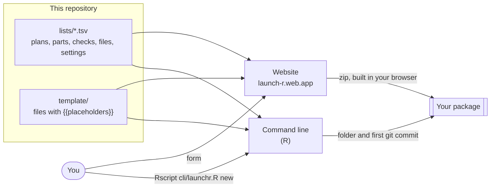
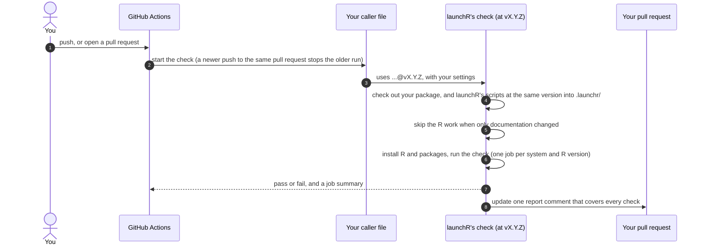

# launchR 

**Start an R package with its checks already running.** launchR makes a new R package, or adds automatic checks to
one you have, from a short form at <https://launch-r.web.app> or from one R command. Each check in your package is a
short file that calls a check kept here, so fixes reach you as a one-line update.

- **Ready on day one:** DESCRIPTION, an example function with tests and help, READMEs that explain your setup, issue
  forms, labels and stage checklists on GitHub.
- **Seven automatic checks on GitHub (CI)**, from R CMD check to secret scanning, with one report comment on each pull
  request.
- **The same checks on your computer:** one quality-gate script prints a PASS or FAIL line per step.
- **No lock-in:** the files you get carry no conditions, and `eject` copies the checks into your repository.

## How a package is made

The website and the command line read the same template and lists, and build the same files.



- The lists hold every choice and default: the four plans, the parts, the checks with their schedules and systems,
  which template file belongs to which part, and the rules for names.
- The site's engine (`site/src/form/engine.js`) and the command line (`cli/R/`) fill the placeholders the same way.
  `tests/compare-routes.mjs` builds every plan through both and compares every file.
- Your answers stay in your browser: the site builds the zip there.

## Your plan decides the defaults

| Plan | Repository | CRAN | What changes |
| --- | --- | --- | --- |
| Public, going to CRAN | public | yes | R CMD check runs as CRAN does, on Linux, Windows and Mac |
| Public, not for CRAN | public | no | R CMD check without CRAN's extra rules |
| Private for now | private | later | Linux only, to save GitHub minutes; CRAN rules from the start |
| Private for good | private | no | Linux only, and no weekly check on other systems |

## What your package gets

| Part | What it adds | Default |
| --- | --- | --- |
| Package skeleton | DESCRIPTION, an example function, a test of each kind, help pages | on |
| CI | The checks below, one short file each in `.github/workflows/` | on |
| GitHub setup | Issue forms, a PR template, labels and stage checklists | on |
| AI setup | `AGENTS.md` with rules files in `.agents/rules/` (the same in every package), and `CLAUDE.md` importing it | off |
| Website | A pkgdown site published to GitHub Pages | off |
| Front-end | JavaScript and CSS, with browser tests | off |

### The checks

| Check | What it does | Runs on |
| --- | --- | --- |
| `r-cmd-check` | R CMD check, as CRAN runs it for a CRAN package | pull requests, pushes, weekly |
| `lint` | Style, docs in sync with the code, spelling | pull requests, pushes |
| `no-suggests` | The package works without its optional packages | pull requests, pushes |
| `secret-scan` | Catches passwords and tokens committed by mistake | pull requests, pushes |
| `coverage` | How much of the code the tests run, with a lower limit | pull requests, pushes |
| `full-tests` | Every test, including the browser, snapshot and extended tests CRAN skips | pull requests, pushes, weekly |
| `r-cmd-check-extended` | R CMD check on more systems, with the extended tests | weekly |

`secret-scan` uses launchR's own rules, not a `.gitleaks.toml` in the package: a false alarm is silenced with a `gitleaks:allow` comment on that line, and a real secret must be removed and its key rotated. To clear a false alarm already in history, add its fingerprint line (in the scan's log, as `file:rule:line` or `commit:file:rule:line`) to `.gitleaksignore` in a pull request; it applies once merged. Keep `^\.gitleaksignore$` in `.Rbuildignore`, or R CMD check notes it as a hidden file.

Every check except `secret-scan` can also be started by hand from the Actions tab. You choose the systems, R versions,
oldest R and weekly time on the site; the package's `.github/workflows/README.md` lists what you chose and how to
change it, and `tests/README.md` explains the test file kinds.

## How your checks reach launchR

Your package holds only short caller files. Each one names a check here and a launchR release:

```yaml
# .github/workflows/r-cmd-check.yaml in your package (shortened)
on:
  pull_request:
    branches: [main, master]
jobs:
  check:
    uses: insightsurge/launchR/.github/workflows/r-cmd-check.yaml@vX.Y.Z
    with:
      platforms: ubuntu/release, windows/release, macos/release
```



- **Permissions:** each check reads your code; only the report job can write a pull request comment. Pull requests
  from forks and from Dependabot get the job summary instead.
- **Updates:** `.github/dependabot.yml` opens a pull request when launchR has a new minor or major release. It changes
  only the `@v...` part of the caller files. Close it to stay where you are.
- **Leaving:** `eject` copies the checks, their scripts and the quality gate into your repository (`.launchr/` and
  `.github/workflows/launchr-*.yaml`), so nothing calls launchR any more.

## Set up GitHub

With the GitHub setup part, your repository gets a **Set up this repository** workflow. Its first run, from your first
push, only lists what it would make. Run it from the Actions tab to create the labels, a root issue and the stage
checklists (Before public, After public, Before CRAN, ...). It ticks the boxes it can check, such as "CI is green on
the default branch", and links each repository setting it can't change. Run it again at any time: it edits only the
lines it wrote. Labels that aren't launchR's, such as GitHub's own (duplicate, question, ...) and any you made, stay; to
remove them, tick **Also remove labels that aren't launchR's** when you click Run workflow. Dependabot's labels are kept.

The same from R, with the [GitHub CLI](https://cli.github.com) signed in, from your package's folder; this can also
tick the settings boxes:

```r
source("https://raw.githubusercontent.com/insightsurge/launchR/vX.Y.Z/cli/github-setup.R")
```

## The command line

Needs R 4.1 or newer and a clone of this repository; `gh` only for GitHub setup.

```bash
Rscript cli/launchr.R new mypkg                       # asks its questions
Rscript cli/launchr.R new mypkg --yes --owner my-org  # takes the defaults
Rscript cli/launchr.R gate full                       # run the quality gate in the current package
Rscript cli/launchr.R github-setup --dry-run          # show the GitHub changes, change nothing
Rscript cli/launchr.R github-setup --remove-other-labels  # also remove labels that aren't launchR's (not Dependabot's)
Rscript cli/launchr.R eject                           # copy launchR's checks into the current package
```

| `new` flag | Meaning |
| --- | --- |
| `--yes` | Use the flags and defaults instead of asking |
| `--owner NAME` | Your GitHub username or organisation (needed with `--yes`) |
| `--plan a` to `d` | The plan, as on the site: a public CRAN (default), b public not for CRAN, c private for now, d private for good |
| `--title`, `--author`, `--email`, `--year` | DESCRIPTION fields; the same rules as the site's form |
| `--description TEXT` | DESCRIPTION's Description, a sentence or two (default: the title) |
| `--min-r 4.3` | The oldest R the package supports, as x.y (default 4.1); DESCRIPTION gets 4.3.0 |
| `--preset starter` / `everything` | Which parts and checks are on |
| `--public`, `--internal` | Older spelling of the plan: public, and not going to CRAN |
| `--path DIR` | Where to write the package (default: a folder named after it) |
| `--no-git` | Don't make the first git commit |

When it has written the package, `new` prints a few next steps: open the folder, install the dependencies and run the tests, and put the package on GitHub.

## The quality gate

`quality-gate/quality-gate.R` runs the checks on your computer, from the package's folder:

| Mode | Steps |
| --- | --- |
| `fast` (default) | Tools, style, docs in sync, `\value` sections, spelling, pkgdown, R CMD check without tests |
| `tests` | The tests once under covr, coverage, and a check that new lines are tested |
| `full` | Everything above, plus R CMD check with tests, the built tarball, and the no-Suggests check |
| `lint` | The quick static steps only |
| `nosuggests` | R CMD check with only the hard dependencies installed |

It prints one PASS, FAIL or SKIP line per step and exits 0 (all passed), 1 (a step failed), 2 (it could not judge the
package) or 3 (only flaky tests failed). `Rscript quality-gate/quality-gate.R --help` lists the options. A generated
package's `.github/workflows/README.md` shows how to run it without cloning launchR.

## In this repository

| Folder | What it holds |
| --- | --- |
| `site/` | The website (Astro): landing page and form. The form's logic is in `src/form/` |
| `cli/` | The command line: `launchr.R`, with the work in `R/` |
| `template/` | The package files, with `{{placeholders}}` |
| `lists/` | Tab-separated lists read by both the site and the command line |
| `.github/workflows/` | The reusable checks that packages call, and this repository's own site deploy, site tests and sandbox test |
| `.github/actions/`, `.github/scripts/` | Shared steps the checks use: the PR report, baselines, change detection |
| `quality-gate/` | The quality gate |
| `tests/` | Tests for the command line, the two routes, the zip, the PR report builder, generated packages against the gate, and the sandbox test's steps |
| `CONTRIBUTING.md` | For maintainers: add a check or a template file, make a release, run the tests, how the shared workflows are secured |

## Develop and test

```bash
npm --prefix site install
npm --prefix site run dev          # the site, with the template bundled in

Rscript tests/cli-tests.R          # the command line, against a stand-in for gh (about 90 s; needs jq and git)
node tests/compare-routes.mjs      # the site and the command line build the same files, for every plan
node tests/check-zip.mjs           # the zip is sound
bash tests/build-comment-tests.sh  # the pull request report builder, against a fake gh (needs jq, perl, unzip, zip)
tests/gate-matrix.sh               # generated packages pass the quality gate

npx --prefix site playwright install chromium   # once: the browser for the site's tests
npm --prefix site run build
(cd site && npx playwright test)   # the form, each plan's download and its zip, in a real browser
```

Every pull request runs the browser tests, the route comparison, the zip check, the command line's tests, the report
builder's tests, and two linters for the workflows in `.github/` (actionlint for mistakes, zizmor for security
problems) in `.github/workflows/site-tests.yaml`. `CONTRIBUTING.md` says what each test covers and how to run the
linters.

**Before a release, the sandbox test.** Local tests can't show what only GitHub's runners do, such as a step that
hangs on Windows. `.github/workflows/sandbox-e2e.yaml`, started by hand (Actions, sandbox-e2e, Run workflow, on `main`
or the release branch), makes a package on the site with every check, R devel and browser tests on Linux, Mac and
Windows, points its checks at the launchR commit under test, and runs them in the public repository
`insightsurge/launchr-sandbox`: a push to its default branch, and a pull request with a planted fake secret that
secret-scan must catch. It fails when any other check fails, with a link to each failed job, or when the pull request
gets other than one report comment. A passing run takes about 15 minutes; given the release pull request's number,
it posts its report there as one comment. It needs the `SANDBOX_TOKEN` secret described in
`CONTRIBUTING.md`.

The site is published to Firebase Hosting by `.github/workflows/deploy-site.yaml` when a change to `site/`,
`template/` or `lists/` reaches `main`, or when the workflow is started by hand. Google Analytics loads only on that
address, and only after a visitor accepts it in the cookie banner (`site/src/consent.js`).

## Licence

launchR is under the MIT licence (`LICENSE`). The files in `template/`, which are what end up in your package, are
under the Zero-Clause BSD licence (`template-LICENSE`), which asks nothing of you: no notice to keep, no credit to give.
New packages start with the MIT licence in your name; you can change it.
